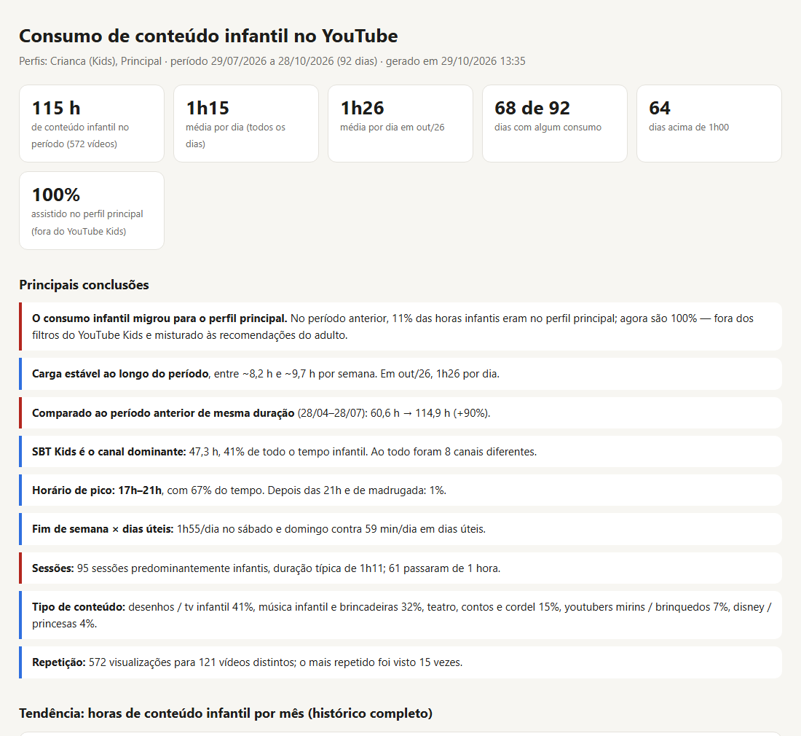
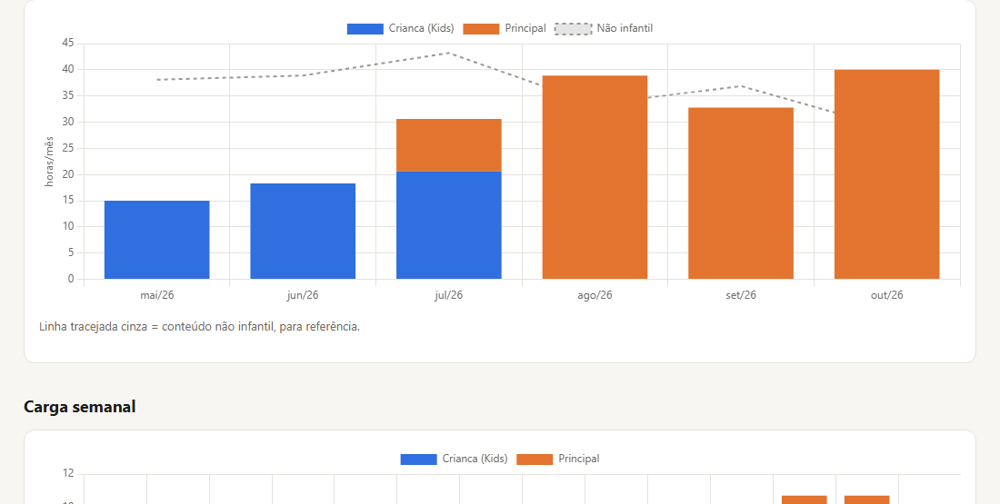
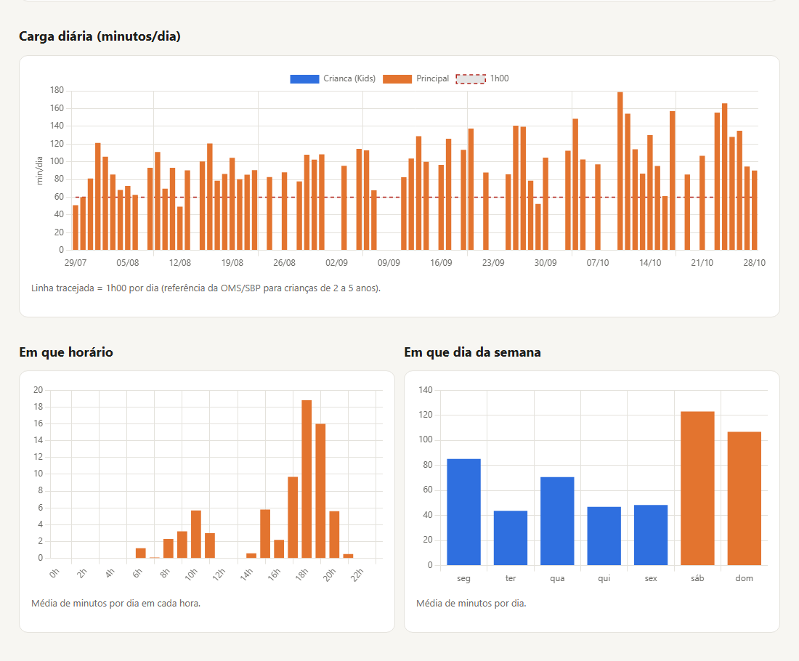
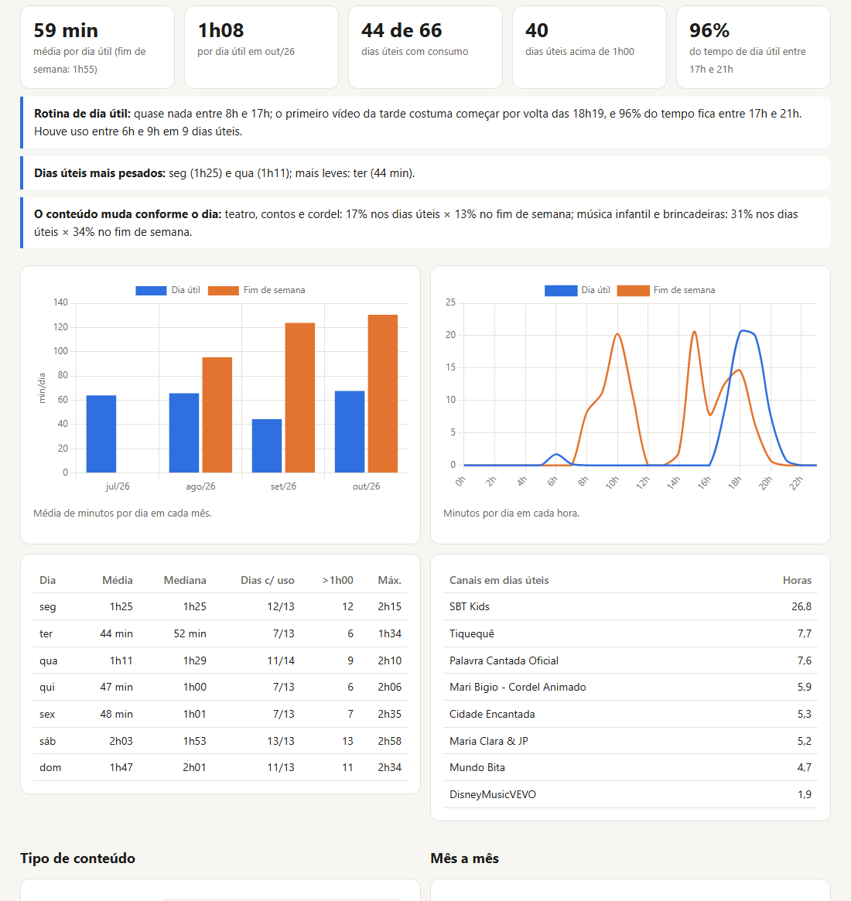
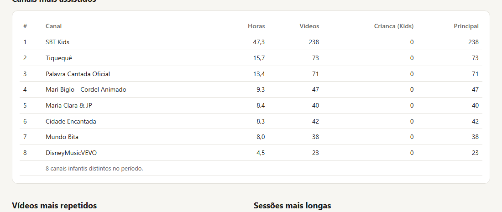

# yt-kids-insights

**Descubra quanto, quando e o quê as crianças da casa assistem no YouTube, a partir da exportação do Google Takeout.**

Você coloca o `.zip` do Takeout numa pasta e recebe um relatório em HTML com horas por dia, semana e mês, horários de pico, dias úteis × fim de semana, canais, tipos de conteúdo, sessões longas e tendências ao longo do tempo. Tudo roda no seu computador, só com Python e sem instalar nada.



> As imagens deste README foram geradas com **dados fictícios** (`sistema/gerar_demo.py`).

---

## Sumário

- [Por que existe](#por-que-existe)
- [O que o relatório mostra](#o-que-o-relatório-mostra)
- [Requisitos](#requisitos)
- [Instalação](#instalação)
- [Passo a passo](#passo-a-passo)
- [Testar com dados fictícios](#testar-com-dados-fictícios)
- [Estrutura de pastas](#estrutura-de-pastas)
- [Como funciona](#como-funciona)
- [Configuração](#configuração)
- [Linha de comando](#linha-de-comando)
- [Privacidade](#privacidade)
- [Limitações](#limitações)
- [Solução de problemas](#solução-de-problemas)
- [Perguntas frequentes](#perguntas-frequentes)
- [Contribuindo](#contribuindo)
- [Licença](#licença)

---

## Por que existe

O YouTube não mostra quanto tempo as crianças passam assistindo, e menos ainda **onde**: muitas vezes elas saem do perfil do YouTube Kids e passam a assistir no perfil de um adulto, sem filtros e misturando as recomendações. O Google Takeout tem o histórico completo de todos os perfis, mas em um HTML de dezenas de megabytes, impossível de ler à mão.

Este projeto transforma esse histórico em respostas diretas:

- Quantas horas por dia, por semana e por mês?
- Está aumentando ou diminuindo?
- Em que horários e dias da semana?
- Quanto acontece no perfil Kids e quanto no perfil do adulto?
- Quais canais e que tipo de conteúdo?
- Há sessões muito longas ou uso tarde da noite?

## O que o relatório mostra

| Seção | Conteúdo |
|---|---|
| **Indicadores** | horas no período, média por dia, média no último mês, dias com consumo, dias acima da referência (60 min), % no perfil principal |
| **Principais conclusões** | textos gerados automaticamente a partir dos números: migração entre perfis, tendência de alta ou queda, comparação com o período anterior, canal dominante, horário de pico, uso noturno, sessões longas |
| **Tendência mensal** | horas infantis por mês e por perfil em todo o histórico, com o consumo não infantil como referência |
| **Carga semanal e diária** | barras empilhadas por perfil, com a linha de referência diária |
| **Horário e dia da semana** | minutos médios por hora do dia e por dia da semana |
| **Dias úteis × fim de semana** | médias, evolução mês a mês, curva por hora, tabela por dia da semana, canais dos dias úteis e rotina típica (hora em que o consumo começa, uso antes da escola) |
| **Tipo de conteúdo** | desenhos e TV, teatro e contos, música, youtubers mirins, Disney (categorias configuráveis) |
| **Canais** | os 20 canais com mais horas, separados por perfil |
| **Repetição e sessões** | vídeos mais repetidos e as sessões mais longas |
| **Metodologia** | como o tempo foi estimado e o que conta como infantil |









O relatório tem tema claro e escuro (segue o sistema), funciona no celular e é um único arquivo `.html`, fácil de guardar ou mandar para alguém.

## Requisitos

- **Python 3.9 ou mais novo.** Só biblioteca padrão, nenhum `pip install`.
- **Windows** para os atalhos `.bat`. Em macOS ou Linux, use a [linha de comando](#linha-de-comando).
- Um navegador para abrir o relatório. Os gráficos usam Chart.js via CDN, então é preciso internet ao abrir.
- Internet durante o processamento é **opcional**: serve só para buscar títulos dos vídeos dos perfis Kids (veja [Como funciona](#como-funciona)).

## Instalação

```bash
git clone https://github.com/fariaswladimir/yt-kids-insights.git
cd yt-kids-insights
python --version
```

Não há mais nada a instalar.

## Passo a passo

### 1. Exporte o histórico no Google Takeout

1. Acesse [takeout.google.com](https://takeout.google.com) com a conta da família.
2. Clique em **Desmarcar tudo** e marque só **YouTube e YouTube Music**.
3. Em **Todos os dados do YouTube incluídos**, deixe pelo menos **histórico** marcado. O histórico dos perfis infantis vai junto, na pasta `crianças/`.
4. (Opcional) Em **Vários formatos**, o histórico pode ficar em **HTML** (padrão) ou **JSON**; os dois funcionam.
5. Crie a exportação e baixe o `.zip` quando o e-mail do Google chegar.

### 2. Coloque o zip na pasta `entrada/`

Não precisa extrair. Funciona também com:

- vários zips de uma exportação dividida (`-001.zip`, `-002.zip`…);
- a pasta já extraída;
- o arquivo `histórico-de-visualização.html` (ou `watch-history.json`) solto.

### 3. Processe

Dê dois cliques em **`1 - Processar agora.bat`**. Em alguns segundos o relatório abre no navegador.

| Atalho | O que faz |
|---|---|
| `1 - Processar agora.bat` | lê o que estiver em `entrada/`, atualiza a base e gera o relatório |
| `2 - Vigiar pasta (automatico).bat` | fica aberto vigiando `entrada/` e processa sozinho quando um arquivo novo termina de copiar |
| `3 - Refazer relatorio.bat` | gera o relatório de novo com a base já acumulada, por exemplo depois de editar a configuração |
| `4 - Gerar dados de exemplo.bat` | cria um Takeout fictício em `entrada/` para testar |

### 4. Veja o resultado

- `ÚLTIMO RELATÓRIO.html`, na raiz: sempre o mais recente.
- `relatorios/relatorio_AAAA-MM-DD_HHMM.html`: o histórico de todos os relatórios gerados.
- `processados/AAAA-MM-DD_HHMMSS/`: os arquivos já lidos, tirados de `entrada/`.

Para acompanhar a evolução, repita a exportação de tempos em tempos (por exemplo, todo mês) e jogue o novo zip em `entrada/`. A base é acumulativa: só os vídeos novos são acrescentados.

## Testar com dados fictícios

Sem ter um Takeout em mãos:

```bash
python sistema/gerar_demo.py
python sistema/processar.py
```

O gerador cria `entrada/takeout-demo.zip` com seis meses simulados: um perfil principal com conteúdo adulto e um perfil Kids chamado "Crianca". Na história simulada, a criança começa no YouTube Kids e depois passa para o perfil do adulto, com mais uso no fim da tarde dos dias úteis.

> Os dados fictícios entram na base (`sistema/base.json`) como qualquer outro Takeout. Para começar do zero depois do teste, apague `sistema/base.json`.

## Estrutura de pastas

```
yt-kids-insights/
├── 1 - Processar agora.bat
├── 2 - Vigiar pasta (automatico).bat
├── 3 - Refazer relatorio.bat
├── 4 - Gerar dados de exemplo.bat
├── entrada/               ← coloque aqui o Takeout
├── processados/           ← entradas já lidas (movidas para cá)
├── relatorios/            ← um HTML por execução
├── ÚLTIMO RELATÓRIO.html  ← cópia do mais recente (gerado)
├── docs/img/              ← imagens deste README
└── sistema/
    ├── processar.py       ← leitura, análise e geração do relatório
    ├── template.html      ← layout e gráficos do relatório
    ├── config.json        ← regras de classificação e parâmetros
    ├── gerar_demo.py      ← gerador de Takeout fictício
    ├── base.json          ← base acumulada (gerado, fica só no seu PC)
    └── cache_titulos.json ← títulos já consultados (gerado, fica só no seu PC)
```

## Como funciona

```
 entrada/*.zip ──► leitura ──► base acumulada ──► títulos dos perfis Kids ──► análise ──► relatorios/*.html
                  (todos os     (sem duplicar)      (oEmbed + cache)          (janela de
                   perfis)                                                     92 dias)
```

### 1. Leitura

O `processar.py` abre os zips **sem extraí-los** e procura os arquivos de histórico de visualização:

- `…/histórico/histórico-de-visualização.html` → perfil **Principal**
- `…/crianças/<Nome>/histórico-de-visualização.html` → perfil infantil **<Nome>**
- os equivalentes em inglês (`history/watch-history.html`, `kids/<name>/…`) e em JSON

Cada vídeo assistido vira um registro com perfil, data e hora, ID do vídeo, título e canal. Anúncios, posts e visitas a canais são descartados. Datas em português ("26 de out. de 2026, 19:06:03") e inglês ("Oct 26, 2026, 7:06:03 PM") são reconhecidas; no formato JSON, que vem em UTC, o horário é convertido para o fuso local.

### 2. Base acumulada

Os registros entram em `sistema/base.json`, sem repetir (a chave é perfil + horário + vídeo). Assim, exportações sucessivas se somam, e o histórico continua disponível mesmo que você limpe o histórico no YouTube depois.

### 3. Títulos dos perfis Kids

No Takeout, o histórico dos perfis infantis vem **só com o link do vídeo**, sem título nem canal. Para recuperar essas informações, o sistema consulta o endpoint público [oEmbed](https://oembed.com/) do YouTube (`youtube.com/oembed`). A consulta é leve e não precisa de chave de API.

- As respostas ficam em `sistema/cache_titulos.json`, então cada vídeo é consultado uma única vez.
- Se o YouTube limitar as consultas (erro 429), o sistema para de consultar e tenta o restante na próxima execução.
- Vídeos removidos ou privados aparecem como "(vídeo indisponível)".
- Para nunca consultar a internet, use `"buscar_titulos_online": false` no `config.json`.

### 4. O que conta como infantil

- **Perfis Kids:** tudo o que foi visto neles.
- **Perfil principal:** o vídeo conta como infantil se:
  - o canal está em `canais_infantis`; **ou**
  - o título bate com a expressão regular `palavras_infantis` (infantil, historinha, Picapau Amarelo, princesas, Frozen…);
  - **e** o canal não está em `canais_excluidos`. Essa lista serve para canais adultos que falam *sobre* infância, como pediatria, críticas de animação ou notícias.

### 5. Estimativa do tempo assistido

O Takeout registra **quando** cada vídeo foi aberto, mas não **por quanto tempo** ele tocou. O tempo é estimado assim:

- cada vídeo recebe o intervalo até o próximo vídeo **do mesmo perfil**;
- se o intervalo passa de `limite_gap_min` (30 min), considera-se que a sessão acabou, e o último vídeo da sessão recebe `ultimo_video_min` (4 min).

Exemplo: vídeos abertos às 18:00, 18:12, 18:20 e o próximo só às 21:00 → 12 + 8 + 4 = **24 minutos**.

Essa regra **subestima** vídeos longos deixados rodando (um episódio de 2 h seguido de nada conta só 4 min) e **superestima** quando a criança abre um vídeo e larga a tela parada. Na prática, para acompanhar tendências e comparar períodos, ela é consistente, porque o erro é parecido de um mês para outro.

### 6. Análise

- **Janela principal:** os últimos `janela_dias` (92) até o último registro da base.
- **Período anterior:** a mesma quantidade de dias imediatamente antes, usada nas comparações.
- **Sessão:** sequência de vídeos do mesmo perfil sem pausa maior que 30 min. Conta como "predominantemente infantil" se ao menos metade dos vídeos é infantil.
- **Tendência:** compara as primeiras semanas da janela com as mais recentes (alta = 1,5× ou mais).
- **Conclusões:** o texto é montado a partir dos números de cada execução e destacado em vermelho (atenção), verde (positivo) ou azul (informativo).

## Configuração

Tudo fica em `sistema/config.json`. Depois de editar, rode `3 - Refazer relatorio.bat`.

| Campo | Padrão | Para quê |
|---|---|---|
| `janela_dias` | `92` | tamanho do período analisado |
| `limite_gap_min` | `30` | pausa (min) que encerra uma sessão |
| `ultimo_video_min` | `4` | minutos atribuídos ao último vídeo de cada sessão |
| `referencia_min_dia` | `60` | linha de referência diária ([OMS](https://www.who.int/publications/i/item/9789241550536)/SBP: até 1 h para crianças de 2 a 5 anos) |
| `buscar_titulos_online` | `true` | consultar títulos dos perfis Kids via oEmbed |
| `canais_infantis` | lista | canais (nome exato) que contam como infantis no perfil principal |
| `canais_excluidos` | lista | canais que **nunca** contam como infantis |
| `palavras_infantis` | regex | termos no título que marcam o vídeo como infantil (sem diferenciar maiúsculas) |
| `categorias` | lista | grupos de conteúdo: cada um com `nome`, `canais` e `palavras` (regex) |
| `categoria_padrao` | `"Música infantil e brincadeiras"` | categoria de quem não cair em nenhuma outra |

### Ajustando a classificação

O jeito mais fácil é olhar a tabela **Canais mais assistidos** do relatório:

- um canal infantil que ficou de fora → acrescente em `canais_infantis`;
- um canal adulto que entrou por engano (por ter "infantil" ou "Frozen" no título) → acrescente em `canais_excluidos`;
- um canal na categoria errada → mova o nome para a lista `canais` da categoria certa.

Exemplo de nova categoria:

```json
{
  "nome": "Ciência para crianças",
  "canais": ["Ciência Todo Dia Kids", "Manual do Mundo"],
  "palavras": "experi[êe]ncia|ci[êe]ncia para crian"
}
```

## Linha de comando

Os `.bat` são só atalhos para estes comandos, que funcionam também em macOS e Linux:

```bash
python sistema/processar.py
```

```bash
python sistema/processar.py --monitorar
```

```bash
python sistema/processar.py --refazer
```

```bash
python sistema/gerar_demo.py
```

| Comando | Efeito |
|---|---|
| `processar.py` | processa `entrada/` uma vez e abre o relatório |
| `processar.py --monitorar` | confere `entrada/` a cada 10 s e processa quando o tamanho dos arquivos para de mudar (cópia concluída) |
| `processar.py --refazer` | regenera o relatório a partir da base, sem ler nada novo |
| `gerar_demo.py [pasta]` | cria um Takeout fictício (por padrão em `entrada/`) |

Para o modo automático iniciar com o Windows, crie um atalho para `2 - Vigiar pasta (automatico).bat` na pasta de inicialização (`Win + R` → `shell:startup`).

## Privacidade

- **Tudo é processado localmente.** Nenhum histórico sai do seu computador.
- A única comunicação externa é a consulta oEmbed dos IDs de vídeo dos perfis Kids (que pode ser desligada) e o carregamento do Chart.js ao abrir o relatório.
- O `.gitignore` é uma **lista branca**: só código e documentação entram no repositório. `base.json`, `cache_titulos.json`, `entrada/`, `processados/`, `relatorios/` e `ÚLTIMO RELATÓRIO.html` ficam de fora.
- Os relatórios têm o histórico de uma criança. Pense bem antes de compartilhá-los.

## Limitações

- **O tempo é estimado**, não medido (veja [a estimativa](#5-estimativa-do-tempo-assistido)).
- **No perfil principal não dá para saber quem estava assistindo.** Um adulto vendo um clipe da Disney conta como infantil, e uma criança vendo um vídeo sem sinais infantis no canal ou no título não conta.
- **Só entra o que o Google registrou:** vídeos vistos sem login, em modo anônimo, em outros apps ou com o histórico pausado não aparecem. Vídeos apagados do histórico também não.
- **TV, celular e tablet não são separados:** o Takeout não informa o dispositivo.
- **A classificação vem afinada para conteúdo brasileiro.** Para outros países, ajuste `canais_infantis` e `palavras_infantis`.
- Se o Google mudar o layout do HTML do Takeout, o leitor pode precisar de ajuste. O formato JSON é mais estável.

## Solução de problemas

| Sintoma | Causa provável e solução |
|---|---|
| "Nenhum histórico de visualização encontrado" | O Takeout não incluiu o histórico. Refaça marcando YouTube → histórico. |
| "Nenhum conteúdo infantil encontrado no período" | Não há perfil Kids e nenhum vídeo do perfil principal bateu com as regras. Ajuste `canais_infantis` e `palavras_infantis`. |
| Muitos vídeos "(sem título)" | O YouTube limitou as consultas oEmbed. Rode `3 - Refazer relatorio.bat` mais tarde: só os que faltam são consultados. |
| Gráficos não aparecem | O relatório precisa de internet para baixar o Chart.js. |
| A janela do `.bat` abre e fecha | O Python não está no PATH. Instale pelo [python.org](https://www.python.org/downloads/) marcando "Add Python to PATH". |
| Acentos estranhos no terminal | Os `.bat` já ativam UTF-8 (`chcp 65001`). Na linha de comando, use `python -X utf8 …`. |
| O relatório começa do zero | `sistema/base.json` foi apagado. Basta processar os Takeouts de novo (estão em `processados/`). |

## Perguntas frequentes

**Preciso de chave de API do YouTube?**
Não. O oEmbed é público e não exige autenticação.

**Funciona com mais de uma criança?**
Sim. Cada perfil em `crianças/<nome>` vira uma série própria nos gráficos e nas tabelas.

**Posso analisar só o perfil principal (sem YouTube Kids)?**
Pode. A classificação por canal e título funciona sozinha; as métricas de "migração entre perfis" só não aparecem.

**Posso mudar o período de 92 dias?**
Sim, em `janela_dias`. A tendência mensal sempre usa o histórico completo.

**Os números batem com o "Tempo assistido" do app do YouTube?**
Não exatamente. O app mede reprodução por dispositivo; aqui é uma estimativa a partir do histórico da conta, que cobre todos os dispositivos logados.

## Contribuindo

Sugestões e correções são bem-vindas: abra uma *issue* ou um *pull request*. Ideias de evolução:

- duração real dos vídeos via YouTube Data API (opcional, com chave do usuário);
- análise do histórico de **pesquisas** dos perfis infantis;
- exportação para CSV/Excel;
- listas de canais infantis para outros países;
- testes automatizados com o gerador de dados fictícios.

Para testar mudanças sem usar dados reais, rode `python sistema/gerar_demo.py` numa cópia limpa do repositório.

## Licença

[MIT](LICENSE) © Wladimir Farias
